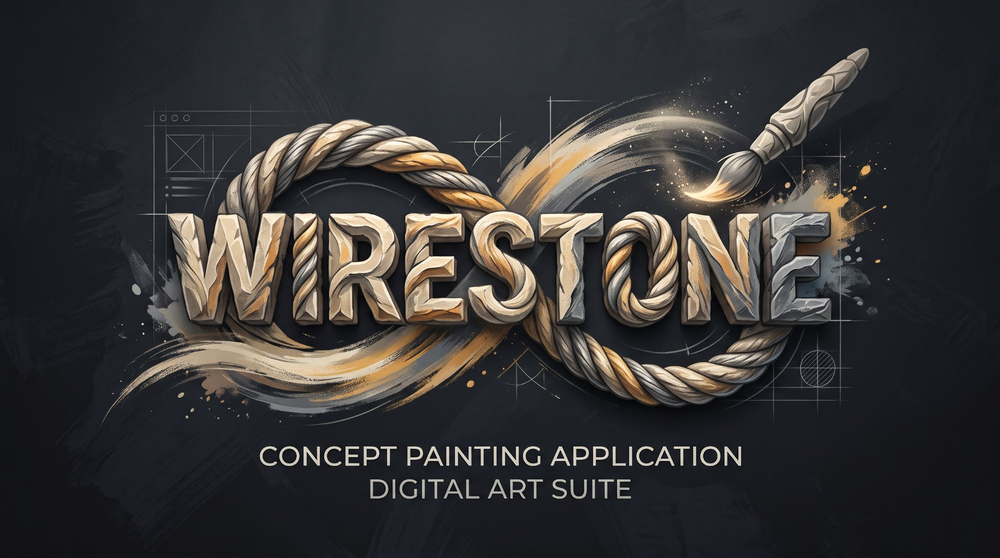
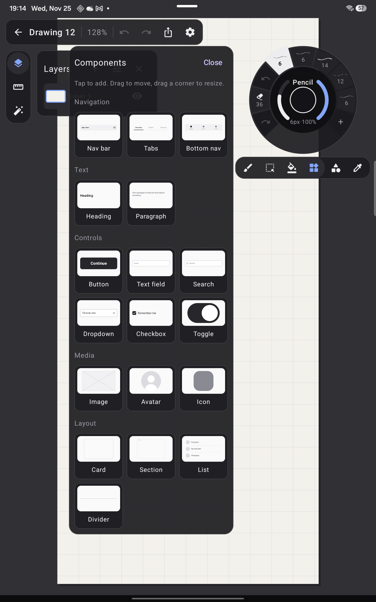
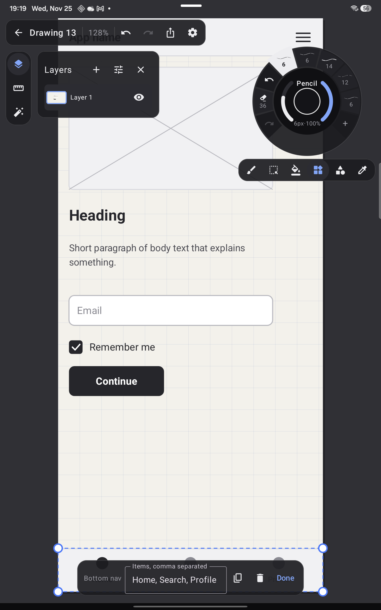
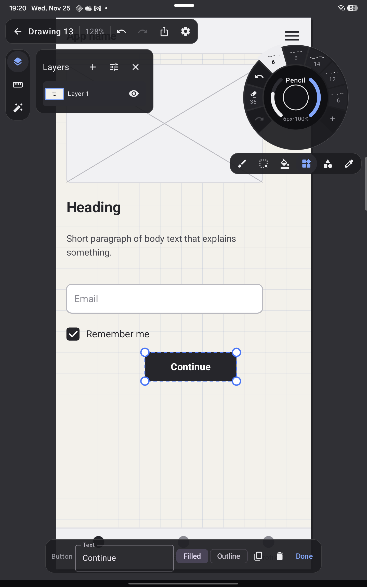
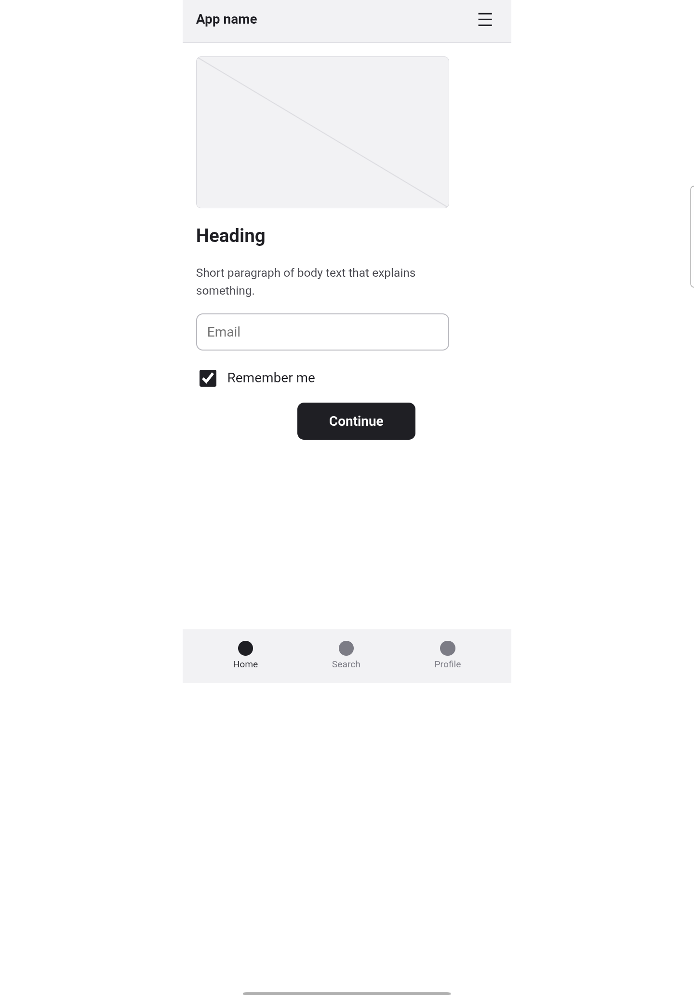
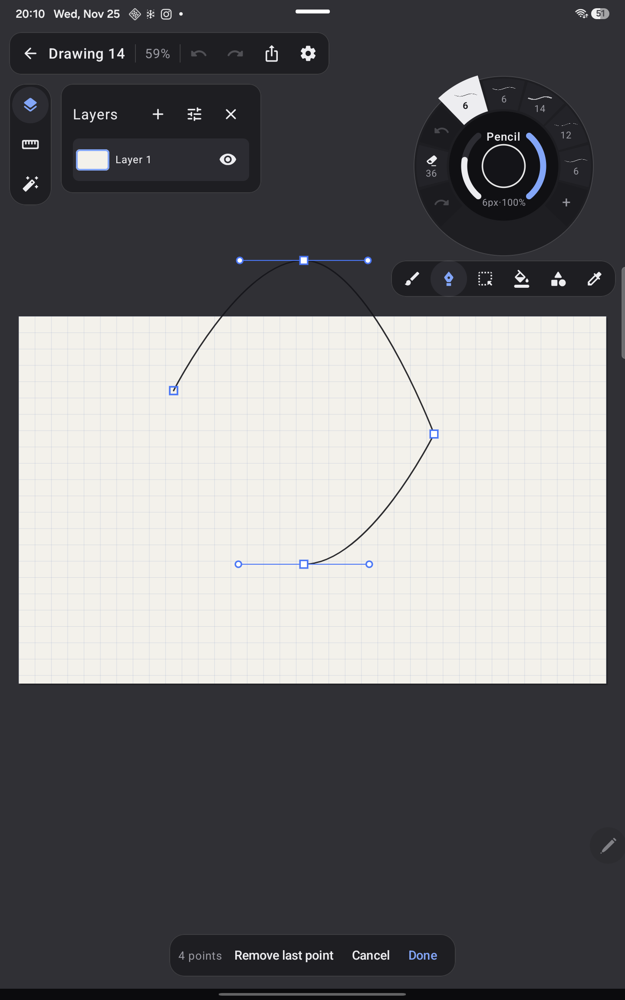
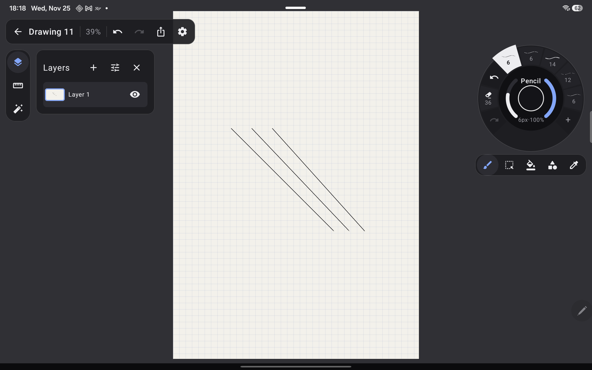

# Wirestone

**Sketch, paint and wireframe on an Android tablet, then turn your screens into real web pages.**

Wirestone is a drawing app for Android tablets and the S Pen. You can sketch, paint, design vector shapes and build app wireframes in one place. Coming soon to Google Play.

## Wireframes that become web pages

Pick a phone, tablet or desktop screen and build it from ready-made blocks: nav bars, buttons, text fields, cards, lists and more. Drag them around, resize them and edit their text. Export the screen as a real, responsive HTML page in one tap.

| Component library | Building a screen | Editing a block | The exported web page |
|---|---|---|---|
|  |  |  |  |

## Draw like a designer

| Pen tool with Bézier handles | Raster painting on an A4 page |
|---|---|
|  |  |

## Features

- **Vector or raster.** Vector strokes stay sharp at any zoom and stay editable; raster paints pixels like real paper.
- **41 brushes**, including inking, painting, airbrush, texture, and blur and smudge brushes.
- **A spinning tool wheel** that keeps your favourite brushes, the eraser, undo and redo under your hand.
- **SnapShape:** hold the pen at the end of a stroke and circles, rectangles, triangles and stars snap clean.
- **Pen tool** with Bézier curves you can reshape point by point.
- **Colour harmonies, 14 colour libraries** (skin tones, foliage, sunsets, UI colours…) and saved colours.
- **Layers** with opacity and blend modes, fill bucket, guides, rulers and measuring.
- **Page sizes** for screens, Full HD, 4K, A4, A5, Instagram, or any custom size.
- **Autosave** and a gallery of all your drawings.

---

Made for the Samsung Galaxy Tab S10 FE and S Pen, and works on Android 10 and up.
